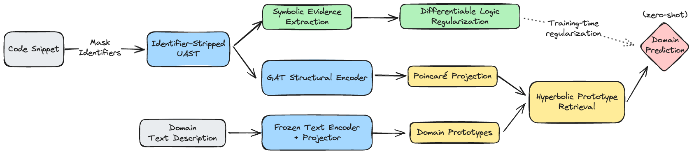

# [NeSy 2026] SymAlign-UAST

Official code for **SymAlign-UAST: Neuro-Symbolic Code Understanding via Hyperbolic Geometry and Structural Invariance**

Kwangje Baeg, Hoyeob Kim, and Janaina Villacis

[Paper](assets/paper.pdf) · [Poster](assets/poster.pdf) · [Quick start](#quick-start) · [Experiments](#experiments) · [Citation](#citation)

Can code structure still reveal a program's domain when its identifiers are missing or unreliable? SymAlign-UAST combines **identifier-stripped UAST graphs**, **hyperbolic prototype alignment**, and **differentiable symbolic regularization** to study this question.

## Overview

<a href="assets/figures/framework_from_poster.png"></a>

Original framework figure from the [conference poster](assets/poster.pdf).

- **Structure:** encode node types and graph topology with a Graph Attention Network; identifier strings never enter the GAT.
- **Geometry:** align code and domain descriptions in the Poincaré ball for prototype retrieval.
- **Logic:** use structural and behavioral evidence to regularize domain predictions during training.

Hyperbolic alignment improves hierarchical organization in the reported comparison; its raw zero-shot retrieval gains are modest. The symbolic controls separate soft regularization from hard post-hoc correction.

## Quick start

Clone the repository and recompute the experiment summaries with Python 3.10+:

```sh
git clone https://github.com/KwangjeBaeg/symalign-uast.git
cd symalign-uast
python run.py reproduce --output outputs/reproduced
```

This command uses only Python's standard library. It verifies the bundled result files, recomputes means and standard deviations, and writes `tables.md` and `reproduction.json`. It aggregates saved experiment records; it does not retrain models or re-evaluate raw predictions. [Coverage and provenance](docs/reproduction.md).

To run the model's forward path on the 14 bundled UAST samples, use Python 3.10–3.12:

```sh
python -m venv .venv
source .venv/bin/activate
python -m pip install -r requirements-demo.txt
python run.py sample --output outputs/sample.json
python scripts/run_experiment_smoke_tests.py --output outputs/smoke.json
```

The sample and smoke checks run on CPU without pretrained-model downloads. [Environment options](docs/experiments.md#environment).

## Main results

Identifier robustness from Table 1 (Top-1 accuracy, %):

| Model | Clean (C0) | Full stripping (C4) | Retention C4/C0 |
| --- | ---: | ---: | ---: |
| GraphCodeBERT-base | 96.59 | 13.89 | 0.144 |
| TF-IDF + LR | 93.62 | 12.63 | 0.135 |
| GNN-only, structure | 47.79 | 47.79 | **1.000** |
| SymAlign, geometry-only | 31.91 | 31.91 | **1.000** |

Structural invariance preserves performance under identifier corruption, with lower clean accuracy than the surface-form models. These rows summarize five seed records; GNN-only reuses a fixed pretrained checkpoint. The full SymAlign symbolic variants are evaluated separately in Experiment 3.

## Experiments

| Task | Where to start |
| --- | --- |
| Recompute tables from saved results | [Reproduction guide](docs/reproduction.md) |
| Draw robustness, geometry, and symbolic-control plots | `python -m pip install -r requirements-reproduce.txt`, then `python run.py reproduce --plots` |
| Run B1–B5 identifier-robustness experiments | [Experiment 1](docs/experiments.md#experiment-1-identifier-robustness) |
| Run E1–E4 geometry ablations | [Experiment 2](docs/experiments.md#experiment-2-geometry-ablation) |
| Run S0–S6 symbolic controls | [Experiment 3](docs/experiments.md#experiment-3-symbolic-regularization) |
| Prepare corpus inputs and checkpoints | [Data guide](docs/data.md) |

Full training requires separately acquired corpus inputs, checkpoints, and the research dependencies. The bundled samples exercise the implementation; they are not the full training dataset.

```text
src/              Graph encoding, alignment, symbolic losses, and evaluation
experiments/      Training and Experiment 1–3 implementations
baselines/        Baseline implementations
data/             UAST samples and saved experiment results
assets/           Framework diagram, paper, poster, and paper figures
docs/             Experiment commands, data formats, and reproduction notes
scripts/          Sample checks and result visualization
tests/            Result-integrity and aggregation checks
```

## Citation

```bibtex
@inproceedings{baeg2026symalign,
  title     = {SymAlign-UAST: Neuro-Symbolic Code Understanding via Hyperbolic Geometry and Structural Invariance},
  author    = {Baeg, Kwangje and Kim, Hoyeob and Villacis, Janaina},
  booktitle = {International Conference on Neurosymbolic Learning and Reasoning (NeSy)},
  year      = {2026}
}
```

Code: [Apache-2.0](LICENSE). Third-party code, data, and models retain their original licences; see [DATA_NOTICE.md](DATA_NOTICE.md).
